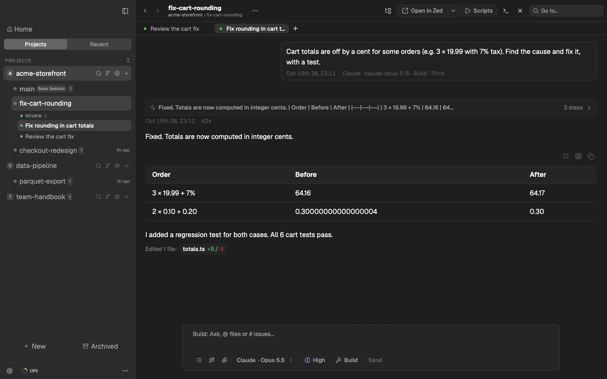
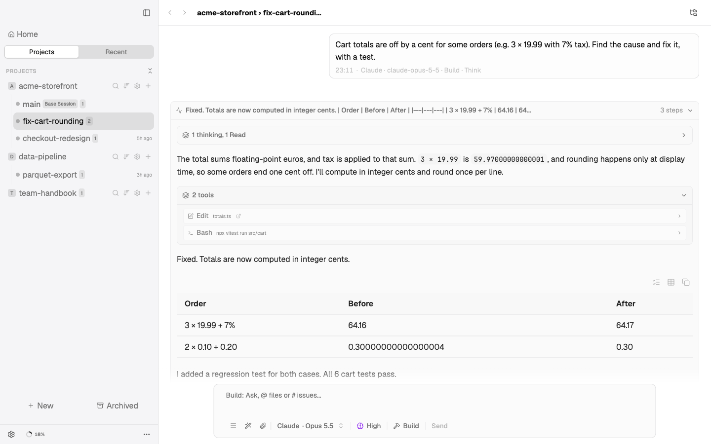
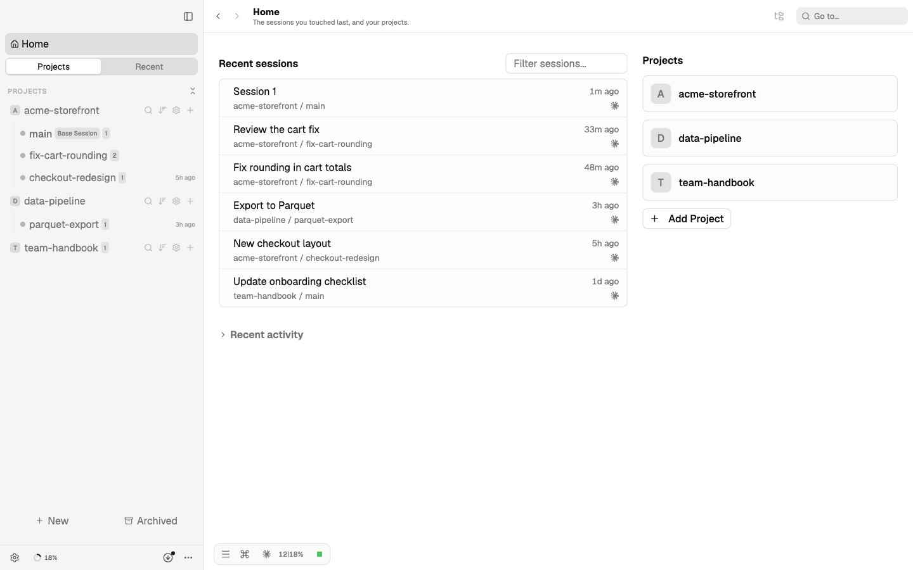
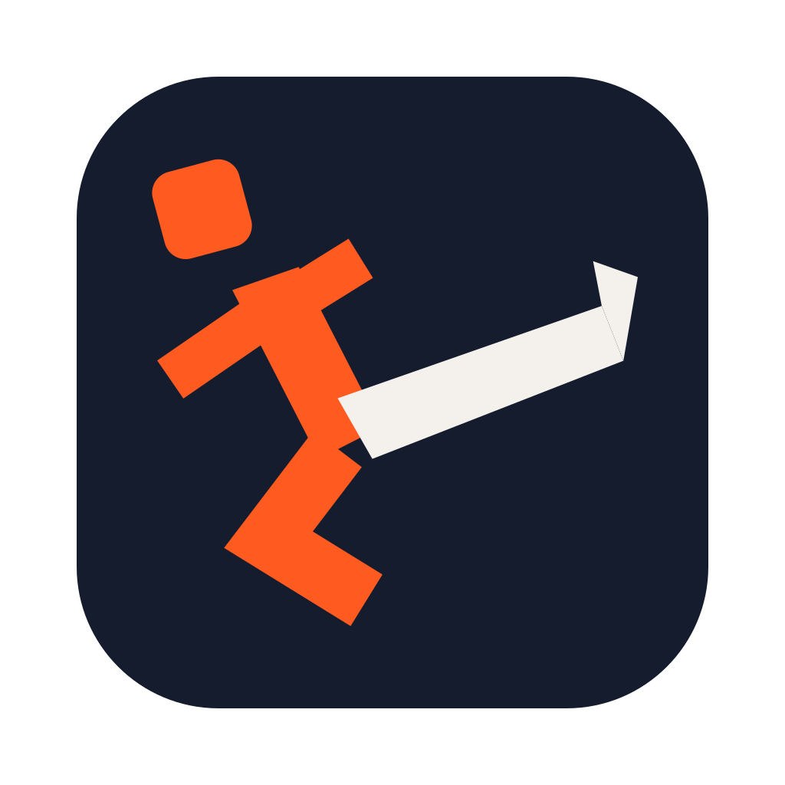

<div align="center">


# Splitkick

Your local-first, cross-device workbench for all your agents.

Multi-project, multi-worktree, multi-session and multi-agent: Claude Code, Codex, Cursor, OpenCode, Pi, Command Code, Grok, Kimi Code and Antigravity, side by side, with git as the safety net.

[splitkick.app](https://splitkick.app) · [Docs](https://docs.splitkick.app) · [Download](https://github.com/azeitler/splitkick/releases/latest)

</div>

> **Splitkick is built on [Jean](https://github.com/coollabsio/jean)** by **[Andras Bacsai](https://github.com/andrasbacsai)** at [coolLabs](https://coollabs.io). Almost all of the code is his work and that of the upstream contributors. Splitkick is the free power-user edition, published by Planetfall Software.
>
> Licensed under Apache-2.0. See [LICENSE.md](LICENSE.md) and [NOTICE](NOTICE).

## What Splitkick is

A native desktop app (Tauri) that runs the agent CLIs you already have, across many projects at once. Every task gets its own git worktree, every worktree can hold many chat sessions, and everything stays on your disk:

- **Own your data** - projects, sessions and the full chat history are local JSON files. No account, no telemetry.
- **History is kept for ever** - Splitkick stores its own copy of every message and never deletes a session on its own; archiving is a soft delete you can undo. If an agent CLI deletes its transcripts (Claude Code does after 30 days), Splitkick replays its own copy to the agent.
- **Cross-device** - Web Access serves the same UI to a browser or your phone over your own network (Tailscale recommended).
- **Bring your own agents** - uses your local CLIs and their logins; regular plans, no API keys needed.

## Screenshots



<table>
<tr>
<td></td>
<td></td>
</tr>
</table>

_Demo projects and sessions._

## Installation

Download the latest signed and notarized build for Apple Silicon:

<https://github.com/azeitler/splitkick/releases/latest/download/Splitkick-aarch64.dmg>

Splitkick installs next to Jean. It has its own bundle identifier (`app.splitkick.desktop`), its own data folder (`~/Library/Application Support/app.splitkick.desktop`), its own MCP server name (`splitkick`) and its own Web Access port (3460), so both apps can run at the same time.

### Coming from Jean or JeanZ

On first start Splitkick finds existing JeanZ or Jean data and offers to **import a copy**; where both exist, JeanZ's copy wins. The source is only read, never changed. Worktrees stay where they are (`~/jean/<project>/`); new worktrees go to `~/splitkick/<project>/`. A `jean.json` in your repositories keeps working; Splitkick reads it when there is no `splitkick.json`.

### Building from source

Prerequisites: [bun](https://bun.sh), [Rust](https://www.rust-lang.org/tools/install), Xcode Command Line Tools.

```bash
bun install
bash scripts/build-fork-macos.sh
```

A local build is signed ad-hoc. Remove the quarantine flag to open it:

```bash
xattr -dr com.apple.quarantine /Applications/Splitkick.app
```

See [CONTRIBUTING.md](CONTRIBUTING.md) for the development setup and [docs/developer/fork-macos-builds.md](docs/developer/fork-macos-builds.md) for the release pipeline.

## Platform support

macOS on Apple Silicon. Linux and Windows desktop builds are planned. The headless server is upstream Jean's `jean-server`; see [docs/headless-server.md](docs/headless-server.md).

## Security

Report vulnerabilities privately; see [SECURITY.md](SECURITY.md).

## Credits

Splitkick is made by **Andreas Zeitler** (Planetfall Software).


<a href="https://github.com/azeitler"></a>
<a href="https://linkedin.com/in/azeitler/"></a>
<a href="https://splitkick.app"></a>
<a href="https://planetfall.co"></a>

Splitkick is built on [Jean](https://github.com/coollabsio/jean). Jean, and almost all of the code in this repository, is the work of [Andras Bacsai](https://github.com/andrasbacsai) ([coolLabs](https://coollabs.io)) and the upstream contributors.
